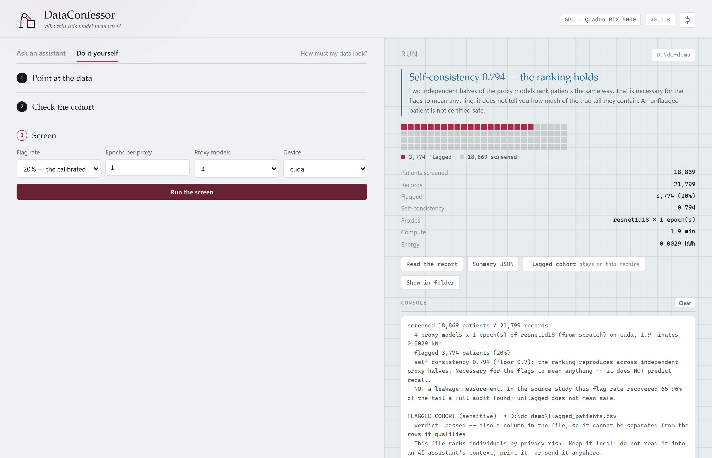

<p align="center">
  
</p>

<h1 align="center">DataConfessor</h1>

<p align="center"><b>Find the patients your model will memorise — before you train it.</b></p>

A model trained on medical records can reveal who was in its training set. That risk is
usually measured after the fact, by training hundreds of shadow models and attacking your
own model. DataConfessor measures the other half of the problem instead: *which* patients
are at risk is a property of the data, so it can be screened during pre-processing, in
minutes, on four throwaway models, before a production model exists.

```bash
pip install dataconfessor
dataconfessor init  /data/images --labels-csv /data/labels.csv --out manifest.csv
dataconfessor screen manifest.csv --patients flagged.csv --report report.html
```

```
screened 2,056 patients / 33,126 records
  4 proxy models x 1 epoch(s) of resnet18 (ImageNet init) on cuda, 16.5 minutes, 0.0191 kWh
  flagged 411 patients (20%)
  self-consistency 0.808 (floor 0.7): the ranking reproduces across independent proxy
  halves. Necessary for the flags to mean anything -- it does NOT predict recall.
  NOT a leakage measurement. Unflagged does not mean safe.
```

<sup>Real output: ISIC-2020, one Quadro RTX 5000. All 411 flagged patients were melanoma
patients, and they held 561 of the 584 melanoma images in the archive.</sup>

## What it is

The screen trains four small models for one epoch each on complementary halves of your
patients, so every record is scored by the two models that never saw it. A record the rest
of the cohort cannot predict is one a model can only fit by **memorising** — that is
atypicality, and it is what puts a patient in the exposed tail. The 20% most atypical
patients are flagged.

In the study behind this tool — more than 7,000 models over six clinical datasets and four
modalities — that flag rate recovered **65–96%** of the patients a full membership-inference
audit placed in the top-5% risk tail, 3.2–4.8 times random flagging, in 1.4–7.4 GPU-minutes
and 37–1,200 times less energy than the audit it replaces.

## Or run it in a browser

```bash
dataconfessor ui
```

<p align="center"></p>

One command opens a local page with two ways in: **ask an assistant** — your own model key,
or a local Ollama so that nothing leaves the building — or **do it yourself**, three steps
with a folder picker and no commands to type. Both end in the same place: the gate verdict,
the flagged share of the cohort, and the report.

While a screen runs, four lamps light one by one as the proxies train, and the finished
report opens inside the page rather than as a loose file on disk.

The server binds `127.0.0.1`, holds a token the page must present, and allows only this
tool's own commands. The page loads no fonts or scripts from the network, and the one output
that identifies people — the flagged-cohort CSV — is deliberately not servable to it.

## What it cost

Every run reports its own energy, because a screen exists to be the cheap alternative to a
shadow-model audit and that is a claim with a number behind it. The meter is the GPU
driver's own counter (NVML), read before and after every attempt — including the fail-safe's
retries — and the boundary is the one the study used: **GPU board only, PUE 1.0**, with CPU,
memory, storage and cooling outside it. `dataconfessor teachers` is metered the same way. A
CPU-only run says *not metered* rather than inventing an estimate from runtime and nameplate
power.

The figures land in the summary JSON (`energy`: joules, kWh, mean watts, boundary), in the
report, and on the page.

## What it is not

- **Not a leakage measurement.** It produces a ranking and a flagged cohort, never a
  probability that a patient is exposed.
- **Not a safety certificate.** An unflagged patient is not shown to be protected; part of
  the tail is always missed.
- **Not a reason to delete anyone.** Removing the most exposed patients exposes the next
  layer, and in one dataset the flagged patients were almost exactly the melanoma patients.
  Keep them and change how they are *learned* — see `dataconfessor teachers`.

## Try it in a minute, on data you can throw away

```bash
python examples/make_synthetic.py --out ./synth      # a cohort with a planted atypical tail
dataconfessor screen ./synth/manifest.csv --patients ./synth/flagged.csv \
    --report ./synth/report.html
```

On this toy cohort the default one-epoch proxies fail the self-consistency check at 0.097 —
and you will watch the tool say so, retrain them at two epochs, reach 0.827 and carry on:

```
self-consistency 0.097 is below the 0.7 floor: the proxies disagree about who is
atypical, which usually means they are under-trained. Retrying with 2 epoch(s).
...
fail-safe escalated the proxies: 1 epoch(s): 0.097 -> 2 epoch(s): 0.827
```

`synth/flagged.csv` then holds 62% of the patients listed in `synth/atypical_truth.txt` —
the tail the generator planted, against the 20% random flagging would give. Real datasets do
not come with a truth file, which is the whole reason the check exists.

## The input: one CSV

```csv
path,label,patient_id
images/ISIC_0015719.jpg,0,IP_3075186
```

`dataconfessor init` writes it for you from a folder of files plus whatever labels CSV the
dataset came with, matching on filename. Images (`.png/.jpg/...`) and `.npy` arrays are read
natively; DICOM, NIfTI and WFDB go through a four-line `--loader` hook. The one rule nothing
downstream can check is that **every record of one person carries the same `patient_id`** —
see `skills/dataconfessor/references/manifest.md`.

## The gate, and what it does when it fails

The only validity check available on a dataset nobody has audited: split the proxy models
into two independent halves, rank patients from each, correlate. Below **0.70** the two
halves disagree about who is atypical, and the ranking is not reproducible.

Almost always that means the proxies are under-trained rather than that the dataset cannot
be screened, so the tool fixes it itself: it reports the failure, retrains at **2 then 5
epochs** (`--max-epochs`), and stops at the first budget that clears the floor. Every run
ends with a verdict you can act on:

| | |
|---|---|
| `passed` | cleared the floor on the first attempt |
| `passed_after_retry` | cleared it after the fail-safe trained the proxies longer |
| `below_floor` | never cleared it — the flags are still written, and they are weaker |

A `below_floor` run still hands you the flags from the most-trained attempt, because a
ranking you know to be shaky is more useful than none; what it does not hand you is the
right to present them as a finding. The verdict goes into the summary JSON, into the report,
and into a **column of the patient CSV**, so the file cannot be separated from its warning.
The exit code stays 0 because the flags were delivered; `--strict` makes `below_floor` exit
3, for pipelines that should stop.

Clearing the floor is a necessary condition, not an optimum: the fail-safe stops at the
first budget that passes, not at the one that ranks best.

## Commands

| | |
|---|---|
| `dataconfessor init` | build `manifest.csv` from a folder + a labels CSV |
| `dataconfessor check` | validate the manifest, describe the cohort — free and instant |
| `dataconfessor screen` | rank patients, flag the top 20%, retry the proxies if the check fails, write the report |
| `dataconfessor teachers` | soft labels for the flagged records (self-distillation) |
| `dataconfessor advise` | the measured mitigations, ranked for your recipe |
| `dataconfessor ui` | all of the above in a browser, served from this machine only |

Two outputs, deliberately separated: `--out` is aggregate-only JSON, safe to log, ticket or
hand to an AI assistant; `--patients` is the flagged cohort, which identifies individuals by
privacy risk and stays on your machine. `--report` is a single self-contained HTML file with
three diagnostic panels and no identifiers.

## With an AI assistant

The repo is also a Claude Code plugin, so an assistant can run the whole screen from a
sentence:

```
/plugin marketplace add ATI-Lab/DataConfessor
/plugin install dataconfessor@dataconfessor
```

```
/dataconfessor my dataset is at /data/derm, labels are in metadata.csv
```

Other ways in, for other tools:

| | |
|---|---|
| any Claude Code project | `cp -r skills/dataconfessor ~/.claude/skills/` |
| claude.ai or the API | zip `skills/dataconfessor/` and upload it as an Agent Skill |
| any other agent | point it at `skills/dataconfessor/SKILL.md` — it is plain Markdown |

The pip package carries its own copy of the skill, so `dataconfessor ui` can hand it to
a model with no checkout present.

The skill tells the assistant how to map an unfamiliar dataset onto the manifest, how to
read the gate, how to escalate when it fails, and — importantly — not to open the flagged
cohort or the records themselves. An open 31B model followed it end to end with no
violations; see `VALIDATION.md`.

## After the screen: protecting the flagged patients

`dataconfessor advise` ranks what the study measured, filtered by your recipe. The headline
ones: raising weight decay to 1e-2 cut the exposed cohort 1.38–2.95x for free; fine-tuning
only part of a foundation model cut exposure from 55% to 22–30% *and* used 60% less energy;
mixup and smaller training sets made things worse.

`dataconfessor teachers` runs the one mitigation that needs computation. It trains two
teachers on complementary patient halves and writes the prediction of the teacher that never
saw each flagged record, so you can train that record on a soft label instead of its true
one. In the study this lowered flagged patients' mean risk from 0.85 to 0.70 for 0.035 of
held-out AUROC, without raising anyone else's risk — and it did **not** lower worst-case
leakage, so it complements differential privacy rather than replacing it.

## Citing this

> Vrettos, K., Tzanis, E., Kondylakis, H., Vassalou, E. E., Doo, F. X. & Klontzas, M. E.
> *Predicting and mitigating privacy risks in medical AI.*

See `CITATION.cff`. MIT licensed.
